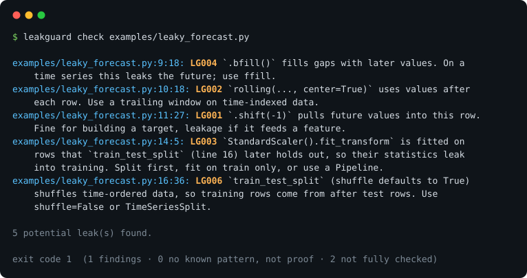

# leakguard

[](https://github.com/Guinerve/leakguard/actions/workflows/ci.yml)


> A linter that warns about common lookahead-bias and data-leakage patterns in pandas and scikit-learn code.



> [!IMPORTANT]
> **leakguard is a warning tool, not proof of clean data.** A finding is a prompt to read the code. A clean run
> means only that none of the patterns below was recognised. On a held-out set of 32 documented leaks it flagged
> 11 (34 %) and stayed silent on the rest ([evaluation](docs/heldout-evaluation.md)).

**Status:** v0.2.0 · 8 rules · CLI, notebooks, flake8 plugin, pre-commit hook · Portfolio project #4 · see `../README.md`

Data leakage produces backtests and models that look great and are wrong, and nothing crashes to tell you. leakguard
reads your code (it never runs it or sees your data) and points at the lines where future or held-out information
can reach a model.

## What it flags

| Rule | Pattern | Will also flag (by design) |
|---|---|---|
| `LG001` | `.shift(-n)` feeding a feature | Plots; skipped when assigned to a target-like name (`target`, `y`, `future`, ...) |
| `LG002` | `rolling(..., center=True)` | Smoothing of non-temporal data (images, space) |
| `LG003` | `fit` / `fit_transform` of a scaler, encoder, imputer, PCA or selector on rows that a later `train_test_split` holds out | Fits whose output only feeds a plot; `LabelEncoder` (learns only the category list) |
| `LG004` | `bfill()`, `backfill()`, `fillna(method="bfill")`, `interpolate()` | Non-time-ordered data |
| `LG005` | `merge_asof(direction="forward" \| "nearest")` | Deliberate alignment to a known later event |
| `LG006` | Shuffled `KFold` / `ShuffleSplit` / `train_test_split` on time-ordered data | Files that only *look* time-series (`import time`, date words); the noisiest rule |
| `LG007` | `fillna(df.mean())` (or median/mode) on rows a later split holds out | |
| `LG008` | `rolling` / `expanding` / `ewm` statistic of the target column without a prior `.shift(1)` | Features that predict a different, later quantity |

`leakguard rules` prints the same list. LG003 and LG007 follow data lineage within a function or module scope:
they check every `train_test_split` in it and track which value of a reused name (`X`, `X_train`) reaches each split.

## Use it

```bash
uv tool install git+https://github.com/Guinerve/leakguard     # or: pip install git+https://github.com/Guinerve/leakguard
leakguard check path/to/code_or_notebooks
leakguard check src/ --select LG003,LG007 --format json
```

From a clone, `uv run leakguard check examples/` runs it on the leaky forecast above and its fixed twin
(`examples/fixed_forecast.py`, which comes back clean).

**pre-commit**

```yaml
repos:
  - repo: https://github.com/Guinerve/leakguard
    rev: v0.2.0
    hooks:
      - id: leakguard
```

**flake8**: installing leakguard in the same environment as flake8 adds the `LG` codes (`flake8 --select LG`).

**Suppress** a reviewed line with `# leakguard: ignore[LG003]` (or `# leakguard: ignore` for every rule).

**Exit codes:** `0` no known pattern found (stderr says this is not proof), `1` findings, `2` something was not
checked: an unreadable file, a non-Python notebook, or a notebook cell that is not valid Python. Findings from the
parts that were checked are still printed, and a pre-commit run fails on `2`. Fix the cell, or keep the file out of
the hook with pre-commit's `exclude:`.

**Notebooks** (`.ipynb`, nbformat 3 and 4): code cells are checked as one scope, as they run. `%time stmt` and
`%timeit stmt` keep `stmt`; `!cmd`, `x = !cmd` and `obj?` are neutralised line by line; `%%time` and `%%capture`
cells are checked; `%%bash`, `%%writefile` and other non-Python cells are named on stderr. Line numbers count
through the concatenated code cells.

## How well it works

| Check | Result |
|---|---|
| **Held-out leaks** ([report](docs/heldout-evaluation.md)): 42 labelled files leakguard had never seen, frozen before the first run | **10 of 32 documented leaks flagged (31 %)** in the protocol run, 11 (34 %) after a lineage fix; 3 of 10 clean files flagged, 2 of them false alarms |
| **Public notebooks**: the 95 in `ageron/handson-ml3` and `jakevdp/PythonDataScienceHandbook` | 9 findings in 4 notebooks, none of them leakage into a model: textbook demos of the exact patterns (`bfill` on a toy Series, centred rolling means on a chart) |
| **Rule fixtures** (`tests/fixtures/`) | Every flagged line carries `# expect: LGxxx`; the test requires the findings to match the markers exactly |
| **Earlier recall check** ([notes](docs/recall-on-documented-leaks.md)): scikit-learn's pitfalls guide, `temporalcv` failure cases | 4 of 7 (57 %) before LG008 was written; 5 of 7 after, in-sample |

The held-out set is the ASE'22 leakage-analysis tool's Kaggle notebooks with the authors' expected results, two
scikit-learn time-series examples, and a look-ahead-bias article's leaky and fixed code. What it missed (21 files; one has two causes):
resampling (SMOTE etc.) before the split (4), fit and split in different functions (4), leaks into
cross-validation folds (3), transformer classes outside the list (3), `pd.qcut` or hand-written standardisation
(3), statistics computed after the split from the wrong rows (2), splits by slicing rather than `train_test_split`
(2), a model evaluated on its own training data (1). Forty-two files is a small sample; the 95 % interval around
34 % runs from 20 % to 52 %.

On the public notebooks, 10 cells in 4 notebooks are named as non-Python (`%%bash`, `%%file`, `%%writefile`) and 1 cell, which
is deliberately invalid Python in the book, is reported as not checked (exit code 2).

Each false positive found along the way became a regression fixture: `date` matching inside `update` (LG006); toy
data, reused names and the stateless `PolynomialFeatures` (LG003); a name rebound to a new dataset between fit and
split; files reported clean when they could not be parsed. See the git history for the full list.

## Limits

- Static analysis cannot see the data. LG001, LG002 and LG004 are pattern matches and cannot tell a chart from a
  feature; LG006 guesses whether a file is time-series and often guesses wrong (15 findings on the held-out set,
  1 real).
- LG003 and LG007 see one function or module scope at a time, only the transformer classes in a fixed list, and only
  `train_test_split` (not positional slicing, not cross-validation folds). Lineage ignores control flow.
- No rule yet for: resampling before a split, `pd.qcut` or manual standardisation on all rows, statistics computed
  after the split from the wrong rows, models evaluated on their training data, thresholds tuned on the full data,
  forecast-horizon gaps.

## Develop

```bash
uv sync
uv run pytest -q                                  # 35 tests
uv run ruff check src tests eval scripts examples
uv run python eval/fetch_marketcalls.py && uv run python eval/run_heldout.py   # held-out set (raw findings)
uv run python scripts/make_hero.py                # regenerate docs/hero.svg from real output
```

CI runs all of this on Python 3.9 and 3.13 and fails if `docs/hero.svg` no longer matches the tool's output.
The held-out files are now in-sample for any rule written after reading them; a new rule needs a new test set
(see the report's last section).

## Roadmap

Ordered by what the held-out set showed: a resample-before-split rule; LG006 using only the split data's own lineage
and ignoring timing code; statistics computed after the split from the wrong rows; `pd.qcut` and manual
standardisation before a split; positional slicing as a split; cross-validation calls as split points. Stretch: a
Ruff plugin and auto-fix suggestions.

## Licence

MIT, see [LICENSE](LICENSE). The held-out corpus keeps its own licences (`eval/heldout/README.md`).

## Definition of done

- [x] Hero GIF or screenshot at the top of this README (`docs/hero.svg`, generated from real output)
- [x] Live demo link or one-command run (`uv run leakguard check examples/`)
- [x] "How I know it's right" section filled in with real results (How well it works)
- [x] Tests passing in CI, badge added
- [x] "Limits" section written
- [x] Licence chosen, repo description and topics set
- [ ] Pinned on GitHub profile and added to guinerve.github.io (the repo is private; both need it public first)
- [x] Added to `career-radar/data/cv/portfolio.json` (via `portfolio/data/projects.ts`)
